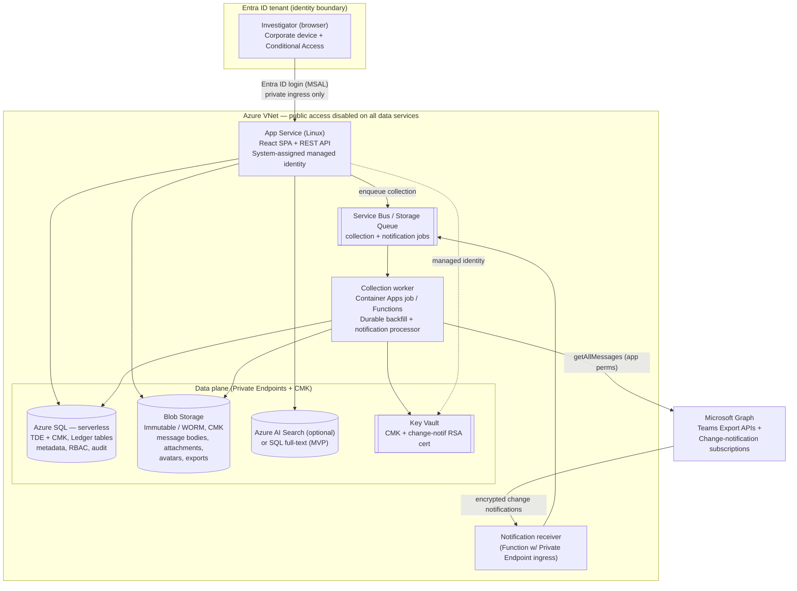

# Cortex-PA — Investigative eDiscovery Platform for Microsoft 365

**Solution & Architecture Design — v1.0**
Author: Design draft for peter@rohlofftech.com · Date: 2026-08-08

> Cortex is an internal, Azure-hosted investigative platform for reviewing and exporting
> Microsoft 365 data in a legally defensible, read-only, chain-of-custody-preserving way.
> **Phase 1 (this design) covers Microsoft Teams chats.** The architecture is built to
> extend to Exchange mail, SharePoint/OneDrive, and other M365 workloads without redesign.

---

## Table of contents

1. [Read this first: feasibility truths](#1-read-this-first-feasibility-truths)
2. [Solution overview](#2-solution-overview)
3. [Azure architecture](#3-azure-architecture)
4. [Data collection design (Teams)](#4-data-collection-design-teams)
5. [Data model](#5-data-model)
6. [Search & filtering](#6-search--filtering)
7. [Conversation rendering (iMessage + Teams views)](#7-conversation-rendering)
8. [Cases](#8-cases)
9. [RBAC & permissions](#9-rbac--permissions)
10. [Security, encryption & isolation](#10-security-encryption--isolation)
11. [Audit log](#11-audit-log)
12. [Export (HTML / Word / Excel)](#12-export-html--word--excel)
13. [Cost model & optimization](#13-cost-model--optimization)
14. [Requirements traceability matrix](#14-requirements-traceability-matrix)
15. [Risks, legal & open decisions](#15-risks-legal--open-decisions)
16. [Phased roadmap](#16-phased-roadmap)

---

## 1. Read this first: feasibility truths

Two facts materially shape what this platform can promise. They are stated up front so the
design is honest about what Microsoft 365 actually exposes.

| Topic | Reality | Impact on design |
|---|---|---|
| **Bulk Teams collection** | The interactive endpoints (`/chats/{id}/messages`) throttle and stop paginating before old history. The **Teams Export APIs** (`getAllMessages`) are the supported bulk path — they return reactions, attachments, edits, **and deleted messages (up to 21 days)**, with date-range filtering. | Collection is built on Export APIs, not the interactive endpoints. |
| **Cost / metering** | **As of 25 August 2025, the Teams Export and change-notification APIs are no longer metered per message.** Previously they billed ~$0.00075/msg under "model=B", or required licenses under "model=A". | The dominant historical cost driver is gone. The remaining Teams-side cost is *licensing prerequisite* (see below), not per-message fees. |

**Licensing prerequisite (not an Azure cost).** The Export APIs run as a *security/compliance*
application ("model=A"). Covered users generally need a supported license (Microsoft 365 E5, or
an E5 Compliance / eDiscovery add-on) with the relevant information-protection capability. This is
a tenant licensing question to confirm with your Microsoft account team — it is independent of the
Azure hosting cost in [§13](#13-cost-model--optimization).

---

## 2. Solution overview

Cortex-PA is a private web application, hosted entirely inside your Microsoft 365 tenant's Azure
subscription, that lets an authorized investigator:

- **Search** across collected Teams chats by person and by a rich set of filters.
- **Review** any discovered conversation in two faithful renderings (Apple Messages style and
  native Teams threaded style) with names, timestamps, avatars, reactions, and status.
- **Organize** work into **Cases** with obscured codenames, immutable case numbers, rich
  descriptions, and custodian/non-custodian rosters.
- **Continuously and silently collect** new chat activity into a case for later review
  (eDiscovery-style), surfaced as an update "bell" with a count.
- **Export** conversations to HTML, Word, or Excel — preserving the threaded layout — scoped to
  *all*, a *date range*, or a *hand-selected set* of messages.
- Operate under **RBAC** (login required, platform roles + per-case Owner/Member roles).
- Produce a tamper-evident, admin-only **audit log** exportable to HTML and CSV.

Everything is **read-only evidence**: nothing collected can be edited, and all data at rest is
encrypted with customer-managed keys and unreachable from the public internet.

### 2.1 A note on the existing repo scaffold

The repo currently contains a React PWA scaffold targeting **Netlify** (`netlify.toml`,
`cortex-pwa-netlify.zip`, IMAP/CalDAV/nodemailer functions). Netlify is a public cloud outside
your M365 tenant and cannot satisfy the "must not be accessible from outside the O365 environment"
and CMK-encryption requirements. This design **replaces the hosting/back-end with an Azure-native
architecture** in the same tenant. The React front-end skeleton can be reused; the Netlify
functions and mail/calendar code are out of scope for Phase 1 and should be retired or moved to a
separate project.

---

## 3. Azure architecture

All resources live in **one Azure subscription bound to your M365 tenant's Entra ID**, in a single
region, inside a private virtual network. Public network access is disabled on every data service;
the app is reachable only from inside the tenant boundary.



### 3.1 Component choices (and why)

| Concern | Choice | Rationale |
|---|---|---|
| Web front-end | React SPA (reuse existing skeleton) served by App Service | Familiar; MSAL for Entra login. |
| API | ASP.NET Core (or Node) on the same App Service | Single deployable; OpenXML export lives here. |
| Collection worker | **Azure Container Apps job** (scale-to-zero) or Durable Functions | Long-running backfill + queue processing; pay only when running. |
| Notification receiver | Azure Function with private ingress | Validates & decrypts Graph change notifications, enqueues. |
| Relational store | **Azure SQL Database, serverless (auto-pause)** | Cases, RBAC, message metadata, full-text search; **Ledger tables** give tamper-evidence for audit & evidence metadata; TDE + CMK. |
| Object store | **Azure Blob Storage, immutable (WORM)** | Message HTML bodies, attachments/hosted images, avatars, generated exports; version-level immutability enforces read-only evidence; CMK. |
| Search | **SQL full-text (MVP)** → **Azure AI Search** at scale | Keeps cost near-zero initially; upgrade path for large tenants and relevance ranking. |
| Secrets/keys | **Azure Key Vault** | CMK for SQL/Blob; the RSA cert used to encrypt change-notification payloads. |
| Async plumbing | Service Bus or Storage Queue | Decouples spikes of incoming notifications from processing. |
| Identity | Entra ID app registration | Delegated (user sign-in) + application permissions (collection). Managed identities everywhere else — **no secrets in code**. |

### 3.2 "Not accessible from outside O365" — how

Two tiers so you can start cheap and harden later:

- **MVP (low cost):** App Service with **Access Restrictions** (allow only the corporate egress /
  service tags), **Entra ID authentication required**, and a **Conditional Access** policy that
  requires a compliant/Entra-joined device and this tenant. Public access **disabled** on SQL,
  Blob, Key Vault via Private Endpoints; App Service reaches them over VNet integration.
- **Hardened:** App Service with **Private Endpoint** ingress behind an **internal Application
  Gateway / Front Door with Private Link**; reachable only via corporate network or **Entra Private
  Access**. No public DNS record resolves to the app.

Either way the evidence data services never expose a public endpoint.

---

## 4. Data collection design (Teams)

Two collection modes feed the same normalized store.

### 4.1 Historical backfill ("all the way back to the first message")

- **APIs:** `GET /users/{id}/chats/getAllMessages` (1:1, group, meeting chats) and
  `GET /teams/{id}/channels/getAllMessages` (channel posts + replies).
- **Filters used:** `$top=250` (recommended throughput), `lastModifiedDateTime` date-range filters,
  and the `from/user/id` filter to target specific custodians and avoid pulling the whole tenant.
- **Permissions (application):** `Chat.Read.All`, `ChannelMessage.Read.All`, `User.Read.All`
  (admin-consented). Meeting recordings/transcripts (`OnlineMeeting*.Read.All`) are reserved for a
  later phase.
- **Payment model:** `model=A` (security/compliance function). No per-message metering after
  Aug 2025; licensing prerequisite per [§1](#1-read-this-first-feasibility-truths).
- **Idempotency:** each message is keyed by Graph message id + `lastModifiedDateTime`; re-collection
  updates in place (captures edits) rather than duplicating. Response order is **not** guaranteed —
  the worker sorts by `createdDateTime` when reconstructing threads.
- **What we capture per message:** body (HTML + text), `from`, `createdDateTime`,
  `lastModifiedDateTime`, `lastEditedDateTime`, `deletedDateTime`, `messageType`, `replyToId`
  (threading), `reactions[]`, `attachments[]`, `mentions[]`, and `hostedContents` (inline images).

### 4.2 Continuous silent collection ("continue collecting" — eDiscovery)

- **Mechanism:** Microsoft Graph **change-notification subscriptions** to
  `/chats/getAllMessages` and `/teams/getAllMessages` (tenant-wide), created with
  `includeResourceData=true` so the encrypted message payload rides along with the notification.
- **Invisible to end users:** subscriptions are server-side (application permissions). There is **no
  client interaction and no user-visible signal** in Teams — this satisfies the "without the user
  being aware" requirement. (See the legal note in [§15](#15-risks-legal--open-decisions): silent
  collection must have a lawful basis; this is a policy control, not a technical one.)
- **Encryption:** the notification receiver decrypts payloads with the private key of an RSA cert
  held in **Key Vault** (public key given to Graph at subscription time). Payloads are validated
  (HMAC-SHA256) before processing.
- **Renewal:** chat/channel message subscriptions are short-lived; a timer job renews them well
  before expiry and rotates the encryption cert on schedule.
- **Case linkage:** when a decrypted message involves a custodian that belongs to a case with
  *Continue collecting* enabled, the worker appends it to that case and **increments the case's
  update counter** — this drives the notification **bell + count** in the UI ([§8.3](#83-continue-collecting--the-update-bell)).

### 4.3 Alternative / complement: Purview eDiscovery

For maximum legal defensibility (holds, retained & deleted content beyond 21 days), the same
architecture can drive the **Microsoft Graph eDiscovery APIs** (cases, custodians, holds, searches,
exports) instead of or alongside the Export APIs. Recommended as a Phase 2 option when formal legal
hold is required; the Export-API + change-notification path is the leaner default.

### 4.4 Chain of custody at ingest

Every collected message and attachment is **SHA-256 hashed at the moment of ingest**, and the hash
+ collection timestamp + collecting identity are stored in a **Ledger table**. Exports carry a
manifest of these hashes so a reviewer can prove nothing changed after collection.

---

## 5. Data model

Relational core in Azure SQL (ledgered where tamper-evidence matters); large/binary content in Blob.

```
Case
  case_id (PK, ULID)            -- immutable
  case_number (unique)          -- e.g. CTX-2026-000123, generated, non-editable
  project_codename (unique)     -- e.g. "SILENT MERIDIAN", random from wordlist, non-editable
  description_html              -- sanitized rich text
  status                        -- Active | Archived
  continue_collecting (bool)
  update_count (int)            -- drives the bell
  created_by, created_at        -- ledgered

Custodian            (case_id FK, name, email, kind: Custodian|NonCustodian)  -- free text
CaseMember           (case_id FK, entra_object_id, role: Owner|Member, granted_by, granted_at)

Conversation                    -- a chat or channel thread scope
  conversation_id (PK)
  source_type                   -- OneOnOne | Group | Meeting | Channel
  graph_chat_or_channel_id
  team_id, team_name            -- for channel scope
  channel_id, channel_name
  topic                         -- chat topic if any
  participants[]                -- resolved identities

Message
  message_id (PK)               -- Graph id
  conversation_id FK
  reply_to_id                   -- threading (channel replies)
  from_object_id, from_display_name
  created_at, last_edited_at, deleted_at
  message_type                  -- message | systemEventMessage | ...
  body_ref                      -- Blob pointer to sanitized HTML body
  content_hash (sha256)         -- ledgered
  case_links[]                  -- which cases this message belongs to (many-to-many)

Reaction     (message_id FK, reaction_type, actor_object_id, created_at)
Attachment   (message_id FK, name, content_type, blob_ref, content_hash)
Mention      (message_id FK, mentioned_object_id, mentioned_display_name)
Identity     (object_id PK, display_name, upn, mail, sam_account_name, avatar_blob_ref)
Tag          (case_id FK, message_id FK, tag_text, tagged_by, tagged_at)
AuditEvent   (ledgered — see §11)
```

Identity resolution stores **display name, email, UPN, and SAM account name** so a person can be
found by any of them ([§6](#6-search--filtering)). Avatars are fetched via `GET /users/{id}/photo/$value`
and cached in Blob; absent photos fall back to initials.

---

## 6. Search & filtering

A single search surface with a default behavior and rich filters. **Default:** searching a user (or
users) returns **every conversation that contains any of them**. Adding participants **narrows**
(AND) to conversations containing all named participants; a "match any" toggle broadens to OR.

| Filter | Backed by |
|---|---|
| **Person** by display name / email / UPN / SAM account name | `Identity` lookup → conversations where they are a participant or sender |
| **One or multiple participants** (AND default, OR optional) | participant set intersection/union |
| **Date range** | `Message.created_at` |
| **Team name** | `Conversation.team_name` |
| **Channel name** | `Conversation.channel_name` |
| **Topic / substring in chat** | full-text over `Message` body (SQL FTS → AI Search) |
| **Has attachment / file** | `Attachment` existence; filter by file name/type |
| **Reactions** | `Reaction` — filter by reaction type and/or reactor; "messages that were reacted to" |
| **Scope: Team or Channel** | `team_id` / `channel_id` |

Results are grouped by conversation with a snippet and participant chips. Selecting one opens the
conversation view ([§7](#7-conversation-rendering)). Every search is scoped by the caller's RBAC:
outside a case you see only permitted data; inside a case, search is confined to that case for
Members.

---

## 7. Conversation rendering

Two faithful view modes over the same normalized data, both **read-only**:

1. **Apple Messages ("iMessage") view** — chronological bubbles; the searched custodian's messages
   aligned to one side, others to the opposite side; sender name + timestamp; reactions rendered as
   bubble tapbacks. This is the default for quick scanning of "what did this person say."

2. **Teams threaded view** — native Teams layout: avatars, display names, timestamps, root posts
   with indented reply threads (via `reply_to_id`), inline images (hosted content), reactions, and
   **status chips**: *Delivered*, *Edited* (with edited timestamp), *Deleted* (tombstone with
   `deletedDateTime`). This is the fidelity view for review and export.

Nothing in either view is editable. There are no edit/delete affordances anywhere in the product.

---

## 8. Cases

### 8.1 Creation

- **Project codename:** random, unique, unchangeable — drawn from a curated two-word wordlist
  (adjective + noun, e.g. `SILENT MERIDIAN`, `AMBER LATTICE`) with a uniqueness check. Once
  assigned it cannot be edited by anyone, including admins.
- **Case number:** auto-generated, unique, immutable (`CTX-{year}-{zero-padded sequence}`; the
  sequence comes from a ledgered counter so numbers can't be reused or altered).
- **Description:** rich-text editor; stored as **sanitized HTML** (server-side sanitization strips
  scripts/handlers) to prevent stored-XSS in an evidence tool.
- **Custodians & non-custodians:** free-text name + email entries, tagged as Custodian or
  NonCustodian.

### 8.2 Working a case

A Case Owner (or Platform Admin) searches for people involved, reviews discovered chats, and **adds
selected conversations/messages to the case**. Work is saved and resumable. Members can view,
export, tag, and search **within the case only**.

### 8.3 "Continue collecting" & the update bell

Toggling *Continue collecting chat data* subscribes the case's custodians to the continuous silent
collection pipeline ([§4.2](#42-continuous-silent-collection-continue-collecting--ediscovery)). As
new messages/threads arrive, they're appended to the case and `update_count` increments. The case
list renders an **information bell with the number of new items**; opening the case's "New since
last review" queue clears the count for that reviewer.

**Legal-authorization gate.** The toggle cannot be enabled until the investigator ticks a required
attestation checkbox:

> ☐ *I confirm that the collection of this user's chats has been authorized by legal and is required
> for an investigation.*

The toggle stays disabled while the box is unchecked. Checking it records the attestation —
**who confirmed, for which case/custodian, and when** — as an audit event ([§11](#11-audit-log)),
and the same actor/timestamp are stamped on the resulting subscription so the authorization is
traceable to the collection it enabled. Un-ticking later (or disabling the toggle) stops new
collection and is itself audited.

---

## 9. RBAC & permissions

Login is **required** (Entra ID). Authorization combines **platform roles** (Entra app roles) with
**per-case roles** (application ACL rows).

### 9.1 Platform roles (Entra app roles)

| Role | Can |
|---|---|
| **Platform Admin** | See and do everything in every case; archive or modify a case on an owner's behalf; view/export the audit log. Trusted to see all information. |
| **Case Creator** | Create cases. **Still only sees cases they created or were granted access to** — creation does not grant tenant-wide visibility. |
| **User / Reviewer** (base) | Sign in; see only cases they've been added to. |

### 9.2 Per-case roles

| Case role | Can |
|---|---|
| **Owner** | Search and **add new chats** to the case; tag; export; manage case membership. Requires the **Case Creator** platform role. |
| **Member** | **View, export, tag, and search within the case only.** Cannot add new chats. |

### 9.3 Enforcement rules (exhaustive mapping to your requirements)

- Users see **only cases they have permission to**, *unless* Platform Admin (sees all). ✔
- To be a **case owner** a user must hold **Case Creator** — but they still see only
  created/permitted cases. ✔
- **Owner** = search + add chats. **Member** = view/export/tag/search-within only. ✔
- **Platform Admin** may perform all roles in any case and may **archive** or **modify a case for an
  owner**. ✔
- **Case-level permissions**: owners (and admins) add other org users to a case as Owner or Member. ✔

Enforcement is server-side on **every** API call: the request's Entra token yields platform roles;
a case-ACL check yields the case role; SQL row-level filtering ensures queries can only return rows
for cases the caller may see. The client UI merely reflects what the server authorizes.

---

## 10. Security, encryption & isolation

| Requirement | Control |
|---|---|
| **Encrypted at rest** | Azure SQL **TDE with customer-managed key**; Blob Storage **CMK**; keys in **Key Vault** (purge protection + soft delete). |
| **Read-only / non-editable evidence** | Blob **version-level immutability (WORM)** with time-based retention/legal hold; the API identity has **read-only** rights on evidence tables/containers — only the *collection* identity writes, and only append. No edit/delete endpoints exist. |
| **Not accessible outside O365** | Private Endpoints + public network access disabled on SQL/Blob/Key Vault; App Service private ingress / access restrictions; Conditional Access requiring compliant device + this tenant ([§3.2](#32-not-accessible-from-outside-o365--how)). |
| **In transit** | TLS 1.2+ everywhere; internal traffic stays on the VNet. |
| **No secrets in code** | Managed identities for all service-to-service auth; Graph app credential and CMK live only in Key Vault. |
| **Tamper-evidence** | SQL **Ledger tables** for audit + evidence metadata; SHA-256 content hashes captured at ingest ([§4.4](#44-chain-of-custody-at-ingest)). |
| **Least privilege on Graph** | Only the four read permissions in [§4.1](#41-historical-backfill-all-the-way-back-to-the-first-message); admin-consented and reviewable. |

---

## 11. Audit log

- **What's captured:** every action — login, search, view conversation, add chat to case, create
  case, change membership, tag, export, archive, **legal-authorization attestation**, subscription
  create/renew — with **timestamp,
  actor display name + UPN, action, and target**.
- **Storage:** append-only **SQL Ledger table**; the ledger's cryptographic digest makes
  after-the-fact tampering detectable.
- **Visibility:** **Platform Admins only** can view or export it.
- **Export:** **HTML** (styled, printable) and **CSV** (date, time, name, action, target, result),
  matching your stated formats.

---

## 12. Export (HTML / Word / Excel)

All three formats **preserve the Teams threaded layout** with names, timestamps, avatars (when
available), reactions, and status; all outputs are **read-only** and carry a **cover manifest**
(case number, project codename, generated-by, generated-at, message count, and SHA-256 hash list
for chain of custody).

| Format | How | Notes |
|---|---|---|
| **HTML** | Self-contained single file: inline CSS, **base64-embedded avatars/images** | Opens anywhere, no external calls; faithful threaded rendering. |
| **Word (.docx)** | Server-side **OpenXML** (DocumentFormat.OpenXml) | Threaded layout via indented paragraphs + avatar images; native Word, not a print-to-PDF. |
| **Excel (.xlsx)** | Rows per message, grouped by thread | Columns: thread id, sender, timestamp, body (text), reactions, attachments, status; threading preserved via thread grouping/indentation so structure survives. |

**Scope selector:** *All messages* (back to the first), a *date range*, or a *hand-selected set*.
Exports are themselves written to immutable Blob and logged in the audit trail.

---

## 13. Cost model & optimization

The big historical cost — per-message Export/notification metering — **no longer applies (Aug 2025)**.
Remaining costs are Azure infrastructure, kept low by design:

| Lever | Choice |
|---|---|
| Compute | App Service (right-sized) + **Container Apps job / Functions that scale to zero** — pay only while collecting/exporting. |
| Database | **Azure SQL serverless with auto-pause** — no charge while idle. |
| Storage | Blob **Hot** for active cases, **Cool/Archive** tiers for aged evidence; dedupe by content hash. |
| Search | Start on **SQL full-text (no extra cost)**; add **Azure AI Search** only when volume/relevance demands it. |
| Network | MVP uses **Access Restrictions** (free) instead of an always-on Application Gateway; add the gateway only in the hardened tier. |
| Region | Single region; no geo-redundant tiers unless compliance requires. |
| Notifications | Tenant-wide `getAllMessages` subscriptions (few subscriptions) rather than per-chat (which hits limits and multiplies cost). |

**Not an Azure cost, but budget for it:** the M365 **licensing prerequisite** for the Export APIs
(E5 / E5 Compliance for covered users) — confirm with your Microsoft account team.

---

## 14. Requirements traceability matrix

Every explicit ask, mapped to where it's satisfied.

| # | Requirement | Where |
|---|---|---|
| 1 | Search Teams chats within the platform | §4, §6 |
| 2 | Search a user → show their chats in Apple-Messages format | §6, §7 (iMessage view) |
| 3 | Search by display name / email / UPN / SAM account name | §5 (Identity), §6 |
| 4 | Filter by date range | §6 |
| 5 | Filter by Team name | §6 |
| 6 | Filter by Channel name | §6 |
| 7 | Filter by topic / substring in chat | §6 (full-text) |
| 8 | Filter by attachment / file | §6, §5 (Attachment) |
| 9 | Filter by channel / Team scope | §6 |
| 10 | Multiple participants or one; default exposes any chat containing the searched user(s) | §6 (default OR-any-of-searched; AND to narrow) |
| 11 | Search & filter by reactions | §5 (Reaction), §6 |
| 12 | Selected chat shown in Teams threaded format | §7 (Teams view) |
| 13 | Names + timestamps | §7 |
| 14 | Export to HTML / Word / Excel, keeping threaded format + names + avatars | §12 |
| 15 | Export all / range / selected set | §12 (scope selector) |
| 16 | Read-only, nothing editable | §7, §10 |
| 17 | Data safe, secure, encrypted | §10 |
| 18 | Create a case to store searches | §8 |
| 19 | Random, unchangeable, obscure project codename | §8.1 |
| 20 | Unique, non-modifiable case number | §8.1 |
| 21 | Rich-text case description | §8.1 |
| 22 | Custodians (name+email, free text) | §5, §8.1 |
| 23 | Non-custodians (free text) | §5, §8.1 |
| 24 | Search anyone in the case, add chats, save & resume | §8.2 |
| 25 | "Continue collecting" without user awareness (eDiscovery) | §4.2, §8.3 |
| 26 | Info bell + count of updates per case | §8.3 |
| 27 | RBAC; login required | §9 |
| 28 | Case-level permissions for org users | §9.2, §9.3 |
| 29 | Users see only permitted cases unless Platform Admin | §9.1, §9.3 |
| 30 | Case Owner vs Member capabilities | §9.2 |
| 31 | Owner requires Case Creator; still sees only own/permitted | §9.1, §9.3 |
| 32 | Platform Admin: all roles, archive, modify for owner | §9.1, §9.3 |
| 33 | Exportable audit log, admin-only | §11 |
| 34 | Audit export in HTML + CSV with dates/times/names/actions | §11 |
| 35 | All data at rest encrypted | §10 |
| 36 | Not accessible outside the O365 environment | §3.2, §10 |
| 37 | Extensible to more data later | §2, §16 |
| 38 | Azure-hosted web app | §3 |
| 39 | Costs mitigated / kept low | §13 |

---

## 15. Risks, legal & open decisions

- **Silent collection is a legal/policy matter, not just a technical one.** "Without the user being
  aware" is achievable technically, but covert collection of employee communications is governed by
  employment law, works-council/labor rules, and jurisdiction. The Export APIs' `model=A` is
  explicitly for *security/compliance* use. Enabling continuous collection therefore **requires the
  investigator to tick the legal-authorization attestation checkbox** described in
  [§8.3](#83-continue-collecting--the-update-bell); the attestation (who confirmed, when) is written
  to the audit log. Consider additionally gating it behind Platform Admin approval.
- **Licensing prerequisite.** E5 / E5 Compliance coverage for custodians must be confirmed with
  your Microsoft account team; otherwise Export API calls may be blocked.
- **Deleted-message window.** Export APIs surface deleted messages for ~21 days; older deletions and
  formal holds need **Purview eDiscovery** ([§4.3](#43-alternative--complement-purview-ediscovery)).
- **Subscription reliability.** Change-notification subscriptions are short-lived and delivered
  out-of-order; the renewal timer and `createdDateTime` sorting mitigate this, but a periodic Export
  API "reconciliation sweep" is recommended to catch any missed notifications.
- **Data residency.** Single-region by default; if collected content has residency obligations,
  choose the region accordingly.

---

## 16. Phased roadmap

- **Phase 0 — Foundations.** Azure landing zone (VNet, Private Endpoints, Key Vault + CMK, SQL
  serverless, Blob WORM), Entra app registration + admin consent, CI/CD.
- **Phase 1 — Teams MVP (this design).** Backfill collection, normalized store, search + filters,
  both conversation views, cases (codename/number/description/custodians), RBAC, audit log, HTML
  export.
- **Phase 2 — Continuous collection & full export.** Change-notification pipeline + update bell,
  Word/Excel export with manifests, tagging, hardened private-ingress networking.
- **Phase 3 — Depth & scale.** Purview eDiscovery/holds option, Azure AI Search, meeting
  transcripts/recordings, and expansion to Exchange mail and SharePoint/OneDrive on the same
  architecture.

---

*This is a design document. No production code, Graph subscriptions, or Azure resources are created
by this document; it defines the architecture and decisions to build against.*
